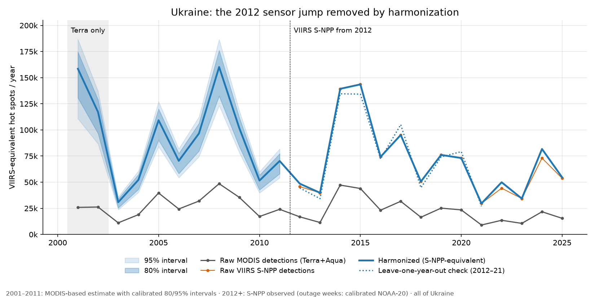
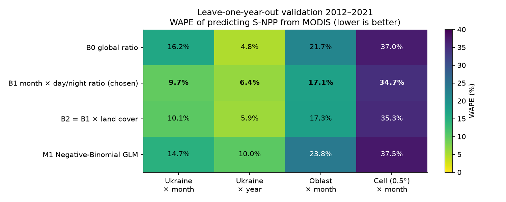
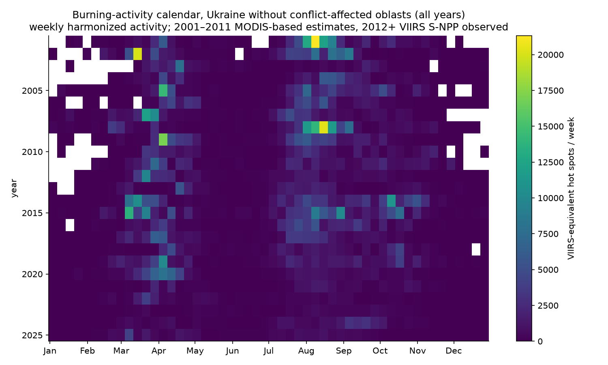
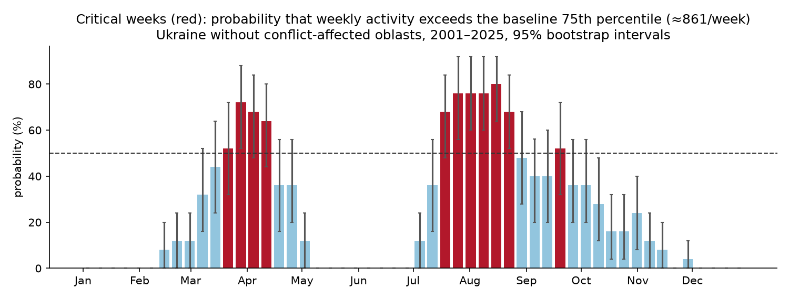
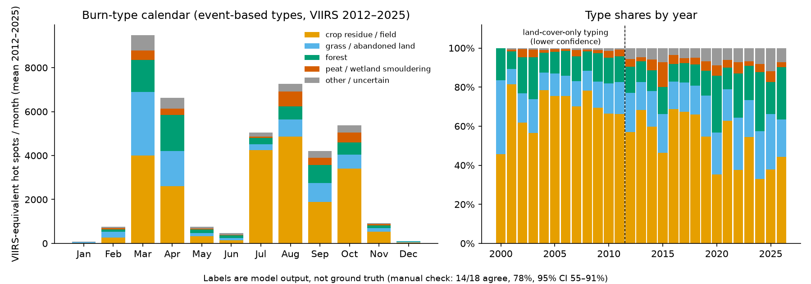
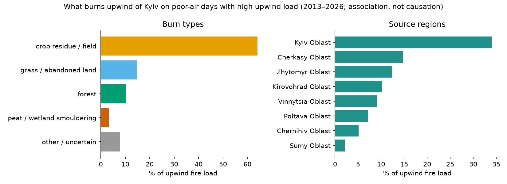
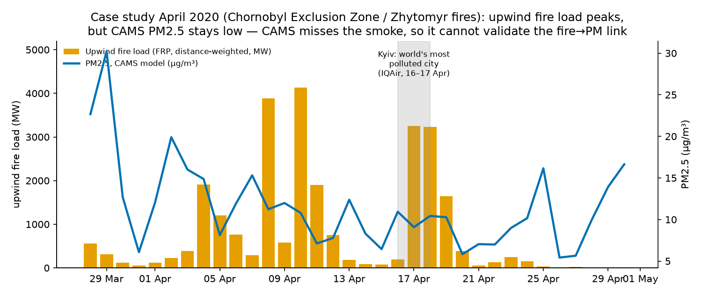

# Harmonized burning-activity calendar for Ukraine (MODIS + VIIRS)

NASA Space Apps Challenge 2026 — *Harmonization of MODIS and VIIRS Hot Spots*.

**Live app:** LIVE_APP_URL · **Code:** https://github.com/vladyslavasachek/modis-viirs-harmonization-ukraine

A web application that turns 26 years of satellite active-fire detections (MODIS 2000–, VIIRS 2012–) into one
consistent **burning-activity calendar** for any area of Ukraine, with uncertainty, anomalies and critical periods —
plus two additions: **automatic burn-type classification** (crop residue, grass, forest, peat) and the link between
**upwind burning and Kyiv's air**.



## Problem
MODIS (1 km, since 2000) and VIIRS (375 m, since 2012) see the same fires very differently: VIIRS records 5–6×
more detections because it resolves small and weak fires. A naive merged record "jumps" in 2012 — a sensor artefact,
not more fire. S-NPP data delivery ended on 2 Nov 2026, so the record must also continue with NOAA-20.

## What the app does
- **AOI:** presets (Ukraine, Kyiv airshed, Chornobyl Exclusion Zone, all 27 oblasts), lat/lon + radius, or a drawn
  polygon; any date range. Domain toggle: *Ukraine without conflict-affected oblasts, all years* (default) or all of Ukraine.
- **Calendar:** weekly series with 80/95% intervals, week × year and month × year heatmaps, annual totals with
  Sen's-slope trend, top months/years, "this month to date vs historical median" card, CSV of the calendar and of the
  individual hot spots; every plot downloads as PNG.
- **Anomalies & critical periods:** leave-one-year-out climatology, percentile anomalies, critical weeks, season
  onset/peak/end and season-shift trends.
- **Burn types:** event-based burn-type calendar, map of events, type shares by year and season, "How does this fire
  compare?" (percentile of an event among same-oblast events).
- **Kyiv air:** daily upwind fire load by burn type and source region (Ukraine + Belarus), case studies, PM2.5 diagnostics.
- **Harmonization** and **Data, methods & limitations** pages.

## Data and attribution
- **NASA FIRMS** active-fire data (standard + near-real-time) for Ukraine and Belarus: **MODIS Collection 6.1**
  (MCD14ML / MCD14DL; Terra, Aqua), **VIIRS 375 m** S-NPP (**VNP14IMG**), NOAA-20 (**VJ114IMG**), NOAA-21.
  We acknowledge the use of data and imagery from NASA's Fire Information for Resource Management System (FIRMS),
  part of NASA's Earth Science Data and Information System (ESDIS).
- **ESA WorldCover 10 m 2021 v200** (© ESA WorldCover project 2021 / contains modified Copernicus Sentinel data, CC BY 4.0).
- **PEATMAP** — Xu, J., Morris, P.J., Liu, J., Holden, J. (2018) *CATENA* 160; dataset doi:10.5518/252, University of
  Leeds, **CC BY 4.0**.
- **ERA5** reanalysis (Copernicus Climate Change Service) via the **Open-Meteo** Historical Weather API.
- **CAMS** European air-quality ensemble (Copernicus Atmosphere Monitoring Service) via the **Open-Meteo** Air Quality API.
- **OpenAQ** (ground-station PM2.5 from low-cost AirGradient sensors in Kyiv, 2023–2026).
- **geoBoundaries** (Ukraine ADM0/ADM1, CC BY 4.0); Chornobyl Exclusion Zone boundary from **OpenStreetMap**
  (relation 3311547, © OpenStreetMap contributors, ODbL); NASA **Worldview** links for visual checks.

## Method (short)
1. **ETL:** FIRMS archive + NRT kept separate (`processing` column). Vegetation fires only (`type = 0`; NRT files have
   no type, so a static-source mask built from standard-processing type-2 detections is applied — 96.8% of type-2
   detections captured, 0.95% of type-0 wrongly masked). MODIS confidence ≥ 30, VIIRS nominal/high. WorldCover class
   attached to every detection.
2. **Harmonization** to the VIIRS S-NPP scale, compared by leave-one-year-out (LOYO) validation on 2012–2021:
   B0 global ratio, **B1 ratio by month × day/night with empirical-Bayes shrinkage**, B2 = B1 × land cover, M1
   Negative-Binomial GLM with an explicit MODIS = 0 term. Separate Terra-only sub-model for Nov 2000 – Jul 2002
   (flagged lower confidence). NOAA-20 calibrated to S-NPP (ratio 1.011, 95% 1.000–1.023) continues the record after
   S-NPP and fills S-NPP outage weeks. Intervals are predictive intervals calibrated on LOYO residuals by predicted
   size and AOI scale.
3. **Calendar statistics:** leave-one-year-out climatology, mid-rank percentile anomalies (not z-scores), critical
   weeks = probability of exceeding the pooled baseline 75th percentile (bootstrap CI), season onset/peak/end
   (10/max/90% of cumulative), Mann–Kendall + Sen's slope.
4. **Burn types:** VIIRS S-NPP detections clustered into fire events (≤ 1 km and ≤ 2 days, connected components /
   ST-DBSCAN with min_samples = 1); transparent rules on event features (dominant land cover, duration, night fraction,
   FRP, mapped peat); cross-checked with a Gaussian mixture; pre-2012 and non-S-NPP detections typed by land cover only.
5. **Kyiv upwind fire load:** FRP of detections within 300 km whose bearing from Kyiv is within ±30° of the ERA5 100 m
   wind direction, weighted exp(−d/100 km), with 1–2-day transport lags; split by type and region.

## Validation and key numbers
- **Harmonization (LOYO 2012–2021, WAPE):** B1 wins at the month level — Ukraine × month 9.7% (B0 16.2%, M1 14.7%),
  oblast × month 17.1% (B0 21.7%, M1 23.8%). **B0 is slightly better at the yearly level (4.8% vs 6.4%), but B1 wins
  at month level, which is what the calendar uses.** The more complex GLM did not validate better than the ratios.
  Terra-only sub-model: 11.9% Ukraine × month. Interval coverage (cross-validated): 80% intervals cover 72–81%,
  95% intervals 90–96% across Ukraine/oblast/cell × week/month/year. Applying the 2012–2021 model to 2022–2025
  out of sample: +5.8% bias, 8.0% Ukraine × year WAPE.

  
- **Burn types:** CEZ April 2020 fires: 98.5% of detections typed forest (consistent with reported forest/grass
  fires). Kyiv-region peat fires Aug–Oct 2015: only 8% typed peat — **missed** (drained peatlands appear as grassland
  and are not in PEATMAP near Kyiv). GMM cross-check agrees with the rules for 84% of events (ARI 0.44).
  **Manual Worldview check:** 40 events (8 per predicted type), 22 labelled confidently; on 18 with a definite
  predicted type **14 agree — 78% (95% Wilson interval 55–91%)**; crop residue 7/7, forest 4/4, grass 1/1 (7 of 8
  unclear), peat 2/6 (all disagreements). Small, stratified, single-labeller sample: an indicative check only.
- **Kyiv air:** PM2.5 from CAMS (2013–2026) **cannot validate the fire → PM link**: CAMS misses the April 2020 smoke
  episode (Kyiv was rated the world's most polluted city on 16–17 April 2020 while CAMS PM2.5 stayed at 6–16 µg/m³)
  and assimilates satellite-FRP-based fire emissions (partly circular); adding fire load gives no out-of-sample gain
  (R² 0.651 → 0.650). Ground stations (OpenAQ, low-cost sensors, Sept 2023 – Nov 2026 only): small out-of-sample
  gain (R² 0.305 → 0.322), not on high-PM days.

## Key findings
- **The 2012 jump disappears** after harmonization; the LOYO MODIS-based estimate tracks S-NPP over 2012–2021.
- **Critical periods (Ukraine):** late March – mid April (weeks 12–15) and late July – August (weeks 29–34); about
  65% of harmonized activity is cropland/field burning.
- **Trend (constant area: Ukraine without conflict-affected oblasts in all years):** −4.2%/yr 2001–2025 (Sen's slope,
  p = 0.009), same sign in raw Aqua-only (−3.5%/yr) and raw VIIRS-only (−11.2%/yr) series — but **not significant
  before 2022** (2001–2021: −2.4%/yr, p = 0.32), i.e. the decline depends on the war-time years. No cause is attributed.
- **Season timing:** spring onset earlier by ~9 days/decade and summer–autumn onset by ~5 days/decade (2003–2025),
  in both the harmonized and raw Aqua-only series (not a harmonization artefact); not seen in the shorter VIIRS-only window.
- **Kyiv air (main result, an association):** on poor-air days with high upwind load, **crop-residue/field burning
  (64%)**, then grass (15%) and forest (10%) dominate the load, mainly from **Kyiv (34%), Cherkasy (15%), Zhytomyr
  (12%), Kirovohrad (10%) and Vinnytsia (9%) oblasts**; Belarus contributes little. High-PM days have high upwind
  load 1.8× (CAMS) – 2.2× (stations) more often than average days.

| | |
|---|---|
|  |  |
|  |  |



## Limitations
- We count **satellite detections, not officially reported fires**; comparison with official fire statistics (e.g.
  the State Emergency Service of Ukraine) is future work. No detection ≠ no fire (clouds, smoke, overpass timing).
- Harmonized values before 2012 are model estimates (intervals shown). B1 is zero where MODIS saw nothing, so the
  spatial pattern of small VIIRS-only fires is missing before 2012 (cell-level error ≈ 35%). Nov 2000 – Jul 2002 is Terra-only.
- Anomalies and critical periods use point estimates (model uncertainty not propagated); weekly resolution (±7 days).
- Conflict-affected oblasts are approximate oblast-level zones; we do not claim any detection is caused by military activity.
- Burn types are model output; peat is the weakest class and is underestimated near Kyiv; grass is largely
  unvalidated from imagery.
- The fire → PM link is **not validated** with CAMS; station data are short (2023–2026) and low-cost.
- All statistics are descriptive; associations are not causation; no ignition forecasts.

## Run locally
```bash
git clone https://github.com/vladyslavasachek/modis-viirs-harmonization-ukraine.git
cd modis-viirs-harmonization-ukraine
python3 -m venv .venv && .venv/bin/pip install -r requirements.txt
.venv/bin/streamlit run app/app.py
```
The app reads only `data/processed/` (committed, ~41 MB). The pipeline (`src/`) rebuilds it from raw FIRMS
downloads in `data/raw/` (not committed): `etl.py → worldcover.py → aggregate.py → stage2_*.py → build_app_data.py →
events.py → events_validation.py → extra_regions.py → kyiv_air.py → kyiv_air_stations.py → make_figures.py`.
API keys (OpenAQ, optional Meteomatics) go in `.env` (not committed). Tested with Python 3.13.

## License
Code: MIT (see `LICENSE`). Data and derived data products keep the licenses of their original sources (listed above).
